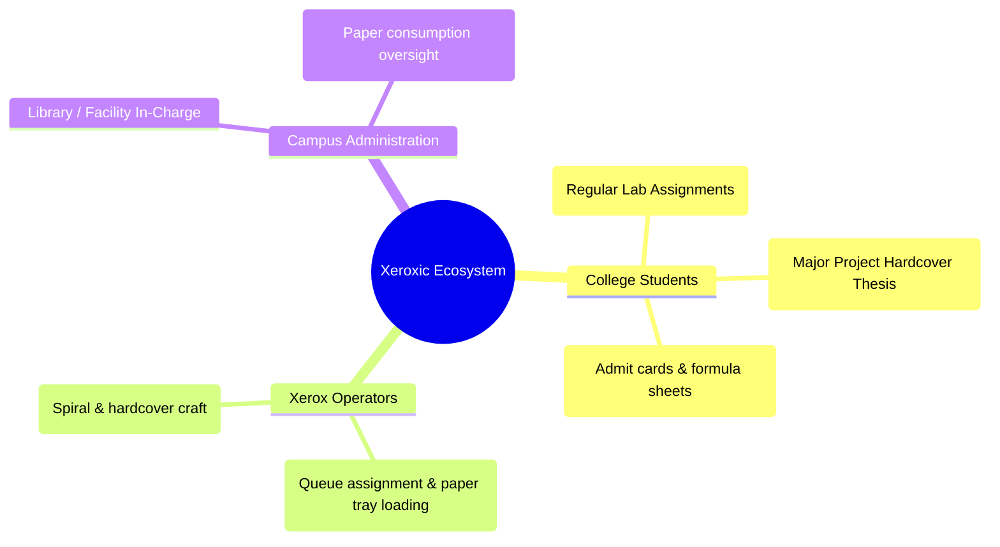
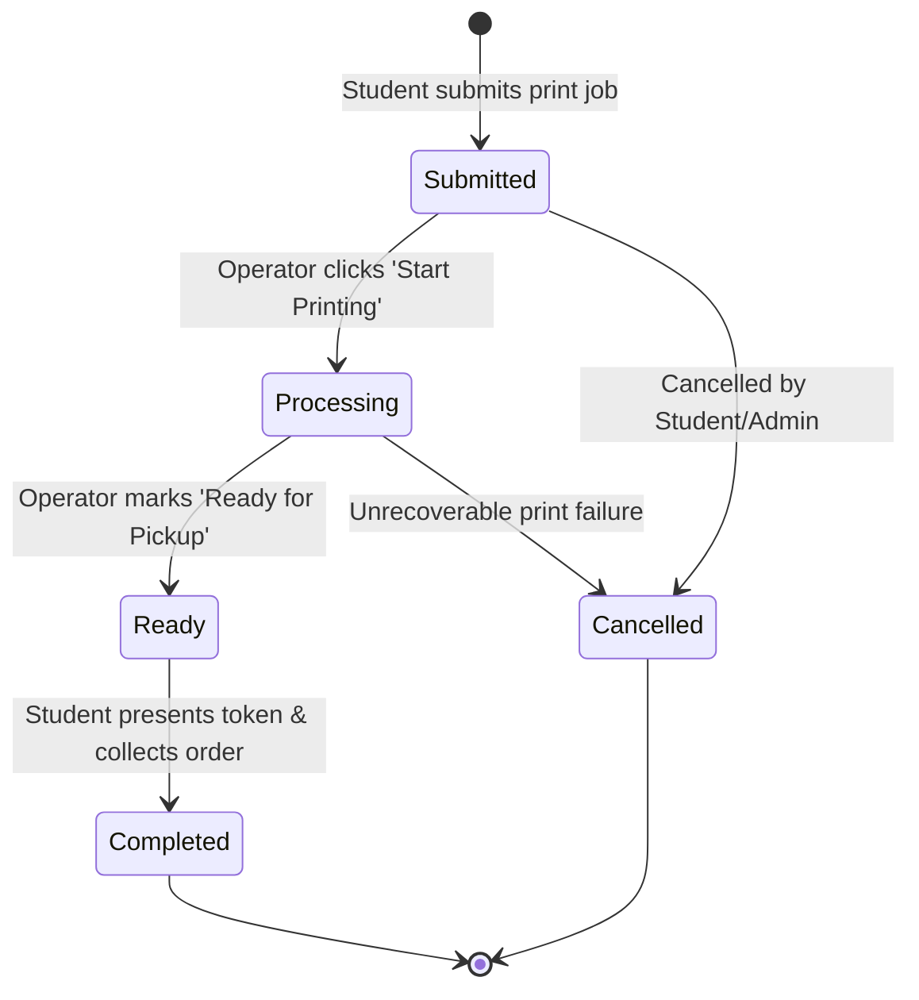
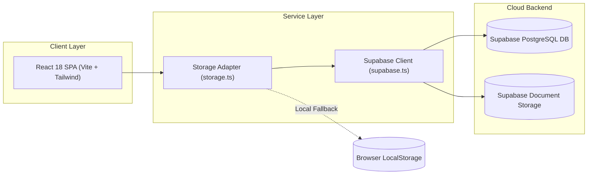
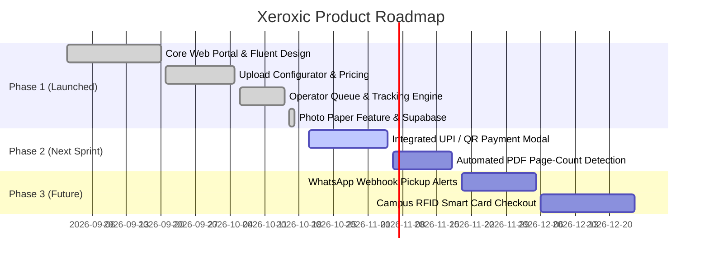

# Product Requirements Document (PRD)

**Product Name:** Xeroxic — Campus Digital Xerox & Print Management System  
**Document Version:** 1.0.0  
**Status:** Approved for Implementation  
**Last Updated:** October 2026  
**Target Release:** v1.0 Production Launch  

---

## 1. Executive Overview & Product Vision

### 1.1 Problem Statement
On university campuses, assignment submission deadlines and examination periods create severe bottlenecks at campus print and xerox shops:
- **Long physical wait queues** (average wait times between 20 to 45 minutes).
- **Instruction miscommunication** (accidental single-sided prints, wrong paper sizes, monochrome vs. color misunderstandings), generating significant paper waste and financial disputes.
- **Physical security and malware risks** from students plugging personal USB flash drives into public xerox computers.
- **Operator cognitive overload**, managing hundreds of unorganized WhatsApp and email attachments simultaneously.

### 1.2 Product Vision
**Xeroxic** transforms the campus printing experience into an on-demand, digital-first workflow. Students upload assignments, thesis documents, and lab manuals directly from their mobile devices or laptops, customize exact print and binding specifications with instantaneous pricing feedback, and pick up their completed orders at dedicated express counters without waiting in physical queues.

### 1.3 Key Performance Indicators (KPIs) & Success Metrics

| Metric | Baseline (Manual Counter) | Xeroxic Target (Post-Launch) |
|---|---|---|
| **Average Counter Wait Time** | 25 minutes | < 2 minutes (Grab-and-Go) |
| **Print Specification Errors** | ~12% of total orders | < 1% |
| **Peak Queue Processing Capacity**| ~40 orders/hour | 150+ orders/hour |
| **Paper Wastage Rate** | ~8% discarded sheets | < 1.5% |
| **Student Satisfaction Score (CSAT)**| 2.8 / 5.0 | > 4.5 / 5.0 |

---

## 2. Target Personas & Stakeholder Analysis



### 2.1 Persona A: The Rushed Undergraduate (Aditi Sharma)
- **Profile:** 3rd Year B.Tech Student, Computer Science.
- **Needs:** Needs a 14-page lab report printed duplex, stapled, before a 9:00 AM lab evaluation.
- **Behaviors:** Mobile-first user; values speed, accurate page estimates, and immediate pickup tokens.

### 2.2 Persona B: The Final-Year Project Lead (Vikram Patel)
- **Profile:** 4th Year Mechanical Engineering Student.
- **Needs:** 120-page Major Project Thesis printed in A4, color cover on **Photo Paper**, hardcover golden-embossed binding.
- **Behaviors:** Desktop user; values transparent pricing breakdowns and special operator instruction notes.

### 2.3 Persona C: The Shop Operator (Ramesh Kumar)
- **Profile:** Commercial xerox machine operator managing 3 high-speed digital presses.
- **Needs:** A clean, high-density order dashboard with distinct visual flags (e.g., `PHOTO PAPER`, `URGENT`, `SPIRAL`), one-click status transitions, and fast token lookup.

---

## 3. Product Scope & MoSCoW Prioritization

### 3.1 Prioritization Matrix

```
       HIGH IMPACT
            ▲
            │  [Must Have]                    [Should Have]
            │  • Web Document Upload           • Supabase Cloud Sync
            │  • Print Parameter Selector      • WhatsApp Pickup Webhook
            │  • Real-Time Price Calculator    • Online UPI QR Checkout
            │  • Live 4-Step Tracker           • PDF Auto-Page Detector
            │  • Operator Admin Queue          
            │
────────────┼──────────────────────────────────────────────────►
            │  [Could Have]                    [Won't Have (v1)]
            │  • Campus RFID Card Swipe        • Full Multi-Campus SaaS
            │  • Dark Mode Theme               • Commercial Ad Network
            │  • Bulk Department Billing
            ▼
       LOW IMPACT / COMPLEXITY
```

- **Must Have (P0):**
  - Document upload supporting PDF, DOCX, PPTX, JPG, PNG (up to 50MB).
  - Print parameter configurator: Color Mode (B&W vs Color), Print Sides (Single vs Duplex), Paper Size (A4, A3, Letter), Paper Type (Plain vs Photo Paper), Binding, Urgent Priority.
  - Live cost calculation engine with zero page-reload latency.
  - Order token generation (e.g. `XER-2026-8841`).
  - Student order tracking page with 4-stage visual progress stepper.
  - Operator queue interface with filtering, search, and instant status progression (`Queued` $\rightarrow$ `Printing` $\rightarrow$ `Ready` $\rightarrow$ `Completed`).
  - Transparent Rate Card display.
- **Should Have (P1):**
  - Cloud database & storage synchronization (Supabase integration).
  - Dedicated admin metrics ribbons (Pending, In Progress, Ready, Daily Volume).
  - One-click order token clipboard copy.
- **Could Have (P2):**
  - Integrated UPI payment gateway modal with QR code generation.
  - Automated WhatsApp or SMS notifications on "Ready for Pickup".
- **Won't Have (Phase 1):**
  - Multi-tenant multi-college franchise billing.
  - In-browser document annotation and inline text editing.

---

## 4. Functional Specifications

### 4.1 Module 1: User Authentication & Role Management
- **User Roles:** `student` and `admin`.
- **Student Access:**
  - One-click student login with student name, roll number, and department.
  - Guest/Demo auto-provisioning to remove onboarding friction for immediate uploads.
- **Admin Access:**
  - Secure credential-based login (`admin@college.edu` / `adminpassword`).
  - Direct redirection to the `/queue` dashboard upon login.

### 4.2 Module 2: Document Ingestion & Validation
- **Dropzone Capabilities:** Drag-and-drop or device file browser.
- **Permitted File Formats:** `.pdf`, `.docx`, `.doc`, `.pptx`, `.ppt`, `.jpg`, `.jpeg`, `.png`.
- **Max File Size:** `50 MB`.
- **Page Count Extraction:**
  - Initial heuristic estimation from file size with manual $+/-$ stepper override.
  - Explicit validation: Minimum 1 page, Maximum 1,000 pages.
- **File Replacement:** 1-click "Replace" trigger allowing users to swap files without resetting chosen print preferences.

### 4.3 Module 3: Print Customization Engine
The system supports six distinct dimension parameters:

| Parameter | Options | Pricing Rule |
|---|---|---|
| **Color Mode** | Black & White (`bw`), Full Color (`color`) | B&W: ₹2.00/page; Color: ₹10.00/page |
| **Paper Type** | Plain Paper (`plain`), Photo Paper (`photo`) | Plain: Included (₹0); Photo Paper: +₹15.00/set |
| **Paper Size** | A4 (`A4`), A3 (`A3`), Letter (`Letter`) | A4/Letter: 1x multiplier; A3: 2x multiplier |
| **Print Sides** | Duplex Back-to-Back (`double`), Single-Sided (`single`) | Duplex: Standard; Single: Full sheet consumption |
| **Orientation**| Portrait (`portrait`), Landscape (`landscape`) | Display / print layout flag |
| **Binding** | None (`none`), Corner Staple (`staple`), Spiral (`spiral`), Hardcover (`hardcover`) | None: Free; Staple: Free; Spiral: ₹25.00; Hardcover: ₹120.00 |
| **Priority** | Standard Queue (Normal), Urgent Express (`isUrgent`) | Urgent: +₹10.00 (Guarantees < 15 min ETA) |
| **Operator Note**| Free text textarea (max 250 characters) | Free-form operational guidance |

### 4.4 Module 4: Pricing Engine Formula

$$\text{Total Cost} = (\text{Page Count} \times \text{Copies} \times \text{Per-Page Rate} \times \text{Paper Multiplier}) + \text{Paper Type Fee} + \text{Binding Fee} + \text{Urgent Surcharge}$$

Where:
- $\text{Per-Page Rate} = \begin{cases} ₹2.00 & \text{if Color Mode is B\&W} \\ ₹10.00 & \text{if Color Mode is Color} \end{cases}$
- $\text{Paper Multiplier} = \begin{cases} 2.0 & \text{if Paper Size is A3} \\ 1.0 & \text{otherwise} \end{cases}$
- $\text{Paper Type Fee} = \begin{cases} ₹15.00 \times \text{Copies} & \text{if Paper Type is Photo Paper} \\ ₹0.00 & \text{if Paper Type is Plain Paper} \end{cases}$
- $\text{Binding Fee} = \begin{cases} ₹0.00 & \text{if None or Corner Staple} \\ ₹25.00 & \text{if Spiral Binding} \\ ₹120.00 & \text{if Hardcover Book} \end{cases}$
- $\text{Urgent Surcharge} = \begin{cases} ₹10.00 & \text{if Urgent is enabled} \\ ₹0.00 & \text{otherwise} \end{cases}$

### 4.5 Module 5: Order State Machine & Live Tracking



- **Order Identification:** Token format `XER-YYYY-XXXX` (e.g. `XER-2026-4819`).
- **4-Stage Progress Visualizer:**
  1. `Queued` — Order verified, waiting in shop queue.
  2. `Printing` — Actively rolling on digital production press.
  3. `Ready for Pickup` — Stapled/bound and staged at Counter 1 or 2.
  4. `Completed` — Handed over to student and archived.
- **Pickup Guidance:** Prominent counter notification banner when state reaches `Ready`.

### 4.6 Module 6: Operator Production Desk (`/queue`)
- **Operational KPI Cards:**
  - `Queued`: Unstarted incoming orders.
  - `In Progress`: Active print jobs on press.
  - `Ready for Pickup`: Orders on the collection shelf.
  - `Delivered Today`: Cumulative count and daily gross revenue (₹).
- **Queue Table Controls:**
  - Search by Token, Student Roll Number, Student Name, or File Name.
  - Instant Filter tabs: All, Submitted, In Progress, Ready, Delivered.
  - Highlighted badges for `PHOTO PAPER` and `URGENT` orders.
  - 1-click status triggers: `[Print Now]`, `[Mark Ready]`, `[Handed Over]`.
- **Job Inspection Modal:** Deep-dive view of full file parameters, student phone number, and special instructions.

---

## 5. Technical Architecture & Data Model

### 5.1 System Architecture



### 5.2 Data Entity Schema (`PrintJob`)

```typescript
export interface PrintJob {
  id: string;                    // Unique token (e.g., 'XER-2026-8841')
  studentId: string;             // User ID of submitting student
  studentName: string;           // Full name of student
  studentRoll: string;           // University Roll Number
  studentPhone: string;          // Contact number
  department: string;            // Academic department
  fileName: string;              // Uploaded document name
  fileSize: string;              // Formatted size (e.g. '3.2 MB')
  fileType: string;              // MIME type
  pageCount: number;             // Total pages
  copies: number;                // Number of sets
  colorMode: 'bw' | 'color';     // Monochrome vs Full Color
  paperSize: 'A4' | 'A3' | 'Letter';
  paperType?: 'plain' | 'photo'; // Plain vs Photo Paper (+₹15)
  orientation: 'portrait' | 'landscape';
  sides: 'single' | 'double';    // Simplex vs Duplex
  binding: 'none' | 'staple' | 'spiral' | 'hardcover';
  isUrgent: boolean;             // Express queue flag
  instructions?: string;         // Operator notes
  cost: number;                  // Total price in INR
  status: 'submitted' | 'processing' | 'ready' | 'completed' | 'cancelled';
  createdAt: string;             // ISO-8601 timestamp
  updatedAt: string;             // ISO-8601 timestamp
  pickupCounter: string;         // 'Counter 1' or 'Counter 2'
  estimatedPickupTime: string;   // Dynamic ETA text
  statusHistory: {
    status: JobStatus;
    timestamp: string;
    note?: string;
  }[];
}
```

---

## 6. Non-Functional Requirements (NFRs)

### 6.1 Performance & Responsiveness
- **Page Load Time:** First Contentful Paint (FCP) under `1.0s`, Time to Interactive (TTI) under `1.8s` on 4G campus Wi-Fi.
- **Client-Side Latency:** Real-time quote calculations executed in `< 10ms` upon any parameter modification.
- **Bundle Optimization:** Production Vite output chunked under `500 kB` gzipped.

### 6.2 Reliability & Availability
- **Offline Resilience:** Dual storage mechanism — if network connectivity to remote Supabase drops, orders cache locally in browser `localStorage` and trigger window events to preserve continuity.
- **Zero Loss on Refresh:** Active form inputs preserved during incidental page refreshes.

### 6.3 Security & Privacy
- **Confidentiality:** Student assignment files are strictly isolated and purged from storage buckets 72 hours post order completion.
- **Role Isolation:** Operator write actions (`updateJobStatus`) restricted to authenticated admin sessions.

### 6.4 Usability & Accessibility (WCAG 2.1 AA)
- Minimum color contrast ratio of `4.5:1` across all text elements.
- Touch target minimum `44 × 44 px` across all mobile viewports.
- Keyboard navigation operable across entire checkout stepper via `Tab`, `Space`, and `Enter`.

---

## 7. Phased Implementation Roadmap



---

## 8. Appendix: Glossary & Definitions

- **Duplex:** Double-sided printing where sheets are printed back-to-back to conserve paper and weight.
- **GSM:** Grams per Square Metre, measuring paper density. Standard xerox uses 75 GSM; photo paper utilizes 180–210 GSM high-gloss stock.
- **MoSCoW:** Prioritization framework classifying requirements into Must have, Should have, Could have, and Won't have.
- **Token ID:** Alphanumeric unique identifier presented by the student at the counter to verify and collect their printout.
