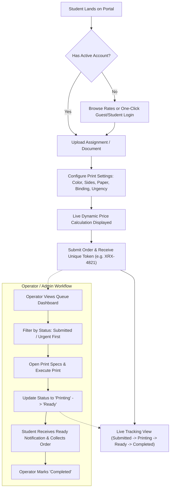

# UI/UX Requirements Specification Document: Xeroxic

**Project:** Xeroxic — Campus Digital Xerox & Print Management System  
**Document Version:** 1.0.0  
**Target Audience:** Product Managers, UI/UX Designers, Frontend Developers, QA Engineers  
**Status:** Approved for Implementation  

---

## 1. Executive Summary & Product Vision

### 1.1 Problem Statement
In traditional college environments, document printing and xerox services suffer from:
- **Long physical queues** during peak assignment and exam submission deadlines.
- **Miscommunication of print preferences** (e.g., wrong paper size, accidental single-sided printing, black-and-white vs. color mismatches).
- **Manual pricing errors** and friction during cash transactions.
- **Lost or unattended documents** cluttering the xerox counter.
- **Lack of progress visibility**, forcing students to wait idly around the shop.

### 1.2 Solution & Value Proposition
**Xeroxic** is an on-campus digital print portal bridging college students and on-premise xerox shop operators. Students can upload their coursework from their phone or laptop, customize exact binding and print parameters with transparent real-time cost estimation, submit orders remotely, and track their pickup status live. Shop operators receive a structured digital production queue, reducing counter congestion and job turnaround time.

---

## 2. User Personas & User Journeys

### 2.1 Persona 1: The Rushed Student (Aditi Sharma)
- **Profile:** 3rd Year Computer Engineering student.
- **Context:** Has an assignment deadline in 30 minutes; needs 15 pages printed, double-sided, stapled.
- **Pain Points:** 15-person line at the library xerox counter, USB drives getting infected by shop PCs, unpredictable wait times.
- **Key UX Need:** Mobile-optimized upload flow, instant quotation, zero-fuss token generation, live status ("Ready for Pickup").

### 2.2 Persona 2: The Xerox Operator / Admin (Ramesh Kumar)
- **Profile:** Campus Xerox Shop Manager handling 400+ print jobs daily across 3 commercial high-speed printers.
- **Context:** Receives hundreds of files, needs quick visibility into paper types, binding requests, and urgent vs. standard orders.
- **Pain Points:** Students hovering at the counter asking "Is mine done?", confusing WhatsApp/email attachments, incorrect change handovers.
- **Key UX Need:** High-density, keyboard-friendly queue interface with distinct status pill states, rapid filter buttons, and one-tap status updates.

### 2.3 User Journey Flowchart



---

## 3. Information Architecture & Navigation

```
Xeroxic Portal
│
├── 🌐 Public / Student Navigation
│   ├── 🏠 Home View (Hero, Workflow Explainer, Live Shop Status, Quick Links)
│   ├── 📤 Upload & Print (Drag-and-Drop, Parameter Configurator, Dynamic Cost Estimator)
│   ├── 📦 Track Printing (Active Orders, Status Stepper, Token Clipboard, History)
│   ├── 🏷️ Rate Card (Detailed Pricing Matrix & Custom Calculator)
│   └── 🔐 Sign In / Account Switcher (Student ID & Admin Portal Access)
│
└── 🛠️ Operator / Admin Portal
    ├── 📋 Live Queue (KPI Stat Cards, Status Filter Chips, Order Detail Drawer, Quick Actions)
    └── 📜 History & Logs (Completed/Archived Jobs, Revenue & Paper Volume Audit)
```

---

## 4. Design System & Visual Guidelines

The design follows a **clean, accessible, enterprise-grade academic aesthetic** inspired by Microsoft Fluent and modern utility dashboards.

### 4.1 Color System

| Token | Hex Value | Semantic Usage |
|---|---|---|
| `--color-primary` | `#0067b8` | Primary CTA, active tabs, brand accents |
| `--color-primary-hover` | `#005da6` | Interactive hover states |
| `--color-bg-canvas` | `#f8f9fa` | Page background |
| `--color-bg-card` | `#ffffff` | Elevated surface containers |
| `--color-border-subtle` | `#e5e5e5` | Dividers, card boundaries |
| `--color-text-main` | `#242424` | Primary headers and high-contrast body text |
| `--color-text-muted` | `#605e5c` | Subtitles, helper text, timestamps |
| `--status-submitted` | `#d83b01` | Amber/Orange: Order submitted, awaiting execution |
| `--status-processing`| `#0078d4` | Blue: Currently printing |
| `--status-ready`     | `#107c41` | Green: Ready for collection at counter |
| `--status-completed` | `#605e5c` | Gray: Finished & collected |

### 4.2 Typography Hierarchy
- **Font Family:** `Segoe UI`, `-apple-system`, `BlinkMacSystemFont`, `Roboto`, `sans-serif`
- **Display Heading:** `28px - 32px`, Semi-bold (`600`), Line-height `1.2`
- **Section Heading:** `20px - 24px`, Semi-bold (`600`), Line-height `1.3`
- **Card Title / Subhead:** `16px - 18px`, Medium (`500`), Line-height `1.4`
- **Body Regular:** `14px`, Regular (`400`), Line-height `1.5`
- **Small / Metadata:** `12px`, Regular or Medium, Line-height `1.4`
- **Token / Monospace:** `13px - 14px`, `Consolas`, `Monaco`, `monospace` (tracking numbers)

### 4.3 Component Specifications

#### A. Interactive Option Cards (Radio Selection)
- Must visually reflect selection with a **2px `#0067b8` outline** and light-blue background tint (`#eff6fc`).
- Must support keyboard focus (`outline: 2px auto #0067b8`).
- Must display sub-labels (e.g., standard price multiplier or binding description).

#### B. File Upload Dropzone
- Default state: Dashed border (`2px dashed #c8c6c4`), clean cloud upload icon.
- Hover/Drag-Over state: Active primary border (`#0067b8`), surface highlight (`#f3f9fd`), scale transform on icon.
- File Loaded state: Displays detected file name, size, estimated page count badge, and a "Replace" or "Remove" button.

#### C. Order Status Progress Stepper
Each order card in the tracker must feature a horizontal 4-step progress line:
1. `Submitted` (Order queued)
2. `Printing` (On press)
3. `Ready for Pickup` (At counter)
4. `Completed` (Collected)

---

## 5. Detailed Screen-by-Screen UI/UX Specifications

### 5.1 Screen 1: Home View (`/`)
* **Primary Objective:** Inform first-time visitors, provide live counter status, and guide students to print or track in under 5 seconds.
* **Key Elements:**
  - **Live Counter Pill:** Dynamic badge showing `🟢 Counter 1 & 2 Open • Queue Time: ~8 mins`.
  - **Hero Section:** Action-oriented headline (*"Skip the Xerox Line. Upload, Print & Collect"*).
  - **Primary CTA Buttons:**
    - `Upload Assignment Now` (Directs to `/upload`)
    - `Track Existing Order` (Directs to `/track`)
    - `View Rate Card` (Directs to `/rates`)
  - **Value Pillars:** Quick turnaround, transparent rates, academic binding options.
  - **Location & Hours Banner:** Library Ground Floor, Room LG-04, Mon-Sat 8:30 AM - 7:30 PM.

### 5.2 Screen 2: Upload & Configure (`/upload`)
* **Primary Objective:** Frictionless file ingestion with instantaneous price feedback.
* **Form Inputs & Layout:**
  - **Column 1 (2/3 width on desktop):**
    - File Dropzone: Supports `.pdf`, `.docx`, `.doc`, `.ppt`, `.pptx`, `.jpg`, `.png` (Max 50MB).
    - Page Count Selector: Auto-inferred with manual +/- override.
    - Number of Copies: Stepper control (Min: 1, Max: 50).
    - Color Option: Black & White (₹2/page) vs. Color (₹10/page).
    - Paper Size: A4 (Standard), A3 (Engineering Drawing), Letter.
    - Print Sides: Double-sided (Eco, recommended) vs. Single-sided.
    - Orientation: Portrait vs. Landscape.
    - Binding Option: None, Corner Staple (+₹0), Spiral Binding (+₹25), Hardcover Project Binding (+₹120).
    - Urgent Flag: Checkbox for Priority Queue (+₹10 surcharge, guaranteed under 15 mins).
    - Special Notes: Multi-line textarea for instructions (e.g., "Print front cover on glossy sheet").
  - **Column 2 (1/3 width sticky on desktop):**
    - **Real-Time Cost Breakdown Card:**
      - Pages calculation: `Pages × Copies × Rate`
      - Paper multiplier: `1x for A4, 2x for A3`
      - Binding fee itemized
      - Urgent priority fee itemized
      - **Grand Total (₹):** Displayed in large, bold font.
      - **Estimated Pickup Counter:** `Library Counter 1`.
      - **Submit Order Button:** Full-width high-contrast button with loading spinner state.

### 5.3 Screen 3: Order Tracking (`/track`)
* **Primary Objective:** Provide peace of mind and minimize counter queries.
* **Key Elements:**
  - **Search & Filter Bar:** Search by Token ID (`XRX-XXXX`) or File Name.
  - **Status Filter Tabs:** `All`, `Active (Submitted / Printing)`, `Ready for Pickup`, `Completed`.
  - **Order Card Specs:**
    - Top Bar: Unique Token ID with a 1-tap **Copy Icon**, Submission Timestamp, Status Badge.
    - File Details: File Name, Page count, Binding format, Total Paid/Due.
    - **Live Stepper Visualizer:** Highlighting the current status with estimated collection time.
    - **Counter Directing Callout:** If status is `Ready`, display prominent green alert: *"Your order is waiting at Counter 1. Show Token XRX-XXXX to collect."*

### 5.4 Screen 4: Rate Card & Pricing Transparency (`/rates`)
* **Primary Objective:** Build trust with 100% upfront pricing and eliminate disputes.
* **Key Elements:**
  - Structured pricing table categorizing standard B&W, Color, Cardstock, Spiral, Softcover, Hardcover.
  - Interactive "Estimate Cost" calculator widget allowing custom page + binding combinations.
  - FAQ section detailing refund rules, cancellation terms, and paper grammage (75 GSM vs 100 GSM).

### 5.5 Screen 5: Admin Queue Management (`/queue`)
* **Primary Objective:** Enable rapid order processing with zero cognitive overload for operators.
* **Key Elements:**
  - **Metric Summary Ribbons:**
    - `Submitted`: Count of unprinted jobs.
    - `In Progress`: Jobs currently printing.
    - `Ready for Pickup`: Orders on shelf waiting for student collection.
    - `Today's Total Jobs & Revenue`: Real-time operational volume.
  - **Search & Filter:** Instant search by student roll number, student name, or order token.
  - **Table / Queue Card Action Controls:**
    - `Start Printing`: Shifts status to `Processing`.
    - `Mark Ready`: Shifts status to `Ready` (triggers pickup readiness).
    - `Hand Over`: Completes order and archives it.
  - **Print Specs Snapshot:** Immediate preview of single/double-sided, color, binding type, and custom student instructions.

### 5.6 Screen 6: History & Auditing (`/history`)
* **Primary Objective:** Keep record of completed and archived print jobs for inventory and accounting.
* **Key Elements:**
  - Date-range filtering.
  - Daily sheets calculation (B&W sheet count, Color sheet count, Binding materials used).
  - Searchable log of past student pickups.

---

## 6. Accessibility & Usability (WCAG 2.1 AA)

1. **Color Contrast:** All body text must maintain a minimum contrast ratio of `4.5:1` against card backgrounds. Status badges must pair color with unambiguous text labels and icons (never rely on color alone).
2. **Touch Targets:** All clickable cards, buttons, steppers, and inputs must have a minimum tap area of `44 × 44 px` on mobile viewport devices.
3. **Keyboard Accessibility:** Logical tab order (`tabindex`) across all form controls, modals closable with `Escape`, selection triggerable with `Space` / `Enter`.
4. **Form Labels & Error States:** All inputs must have visible labels and `aria-describedby` error texts when validation fails (e.g., missing file or zero pages).

---

## 7. Edge Cases & Exception Handling

| Scenario | UX Handling Strategy |
|---|---|
| **Invalid File Type** | Dropzone rejects file immediately with inline red banner: *"Unsupported format. Please upload PDF, Word, or image files."* |
| **Oversized File (>50MB)** | Error banner displayed with tip to compress PDF or export without high-res uncompressed graphics. |
| **Zero Pages Detected** | Page count field displays fallback alert asking student to confirm page count manually. |
| **Printer Jam / Offline** | Admin dashboard provides a 1-click `Delay Notice` updating student tracking status with a revised pickup estimate. |
| **Uncollected Orders** | Orders remaining in `Ready` state after 24 hours receive an amber expiration notice in the student tracker. |

---

## 8. Technology Alignment

- **Framework:** React 18 + TypeScript + Vite
- **Styling:** Tailwind CSS with Microsoft Fluent design tokens
- **Icons:** `lucide-react`
- **State & Persistence:** LocalStorage-backed reactive service (`services/storage.ts`) with custom window event dispatchers for live multi-tab synchronization.
